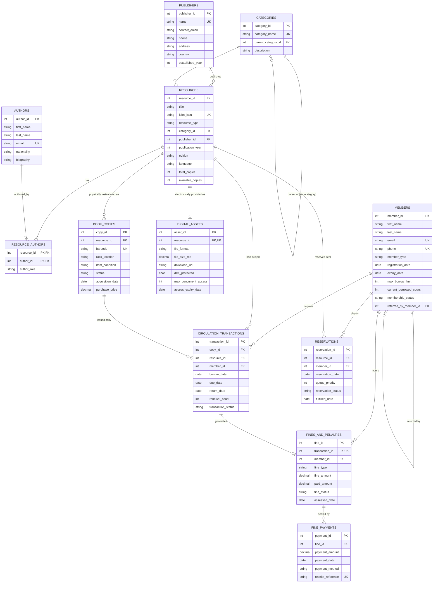

# Entity-Relationship (ER) Diagram & Data Dictionary
## Intelligent Library and Digital Resource Management System (ILDRMS)

---

## 1. Visual Entity-Relationship Diagram (Mermaid ERD)

---

## 2. Cardinality & Relationship Matrix

| Entity 1 | Relationship | Entity 2 | Cardinality | Explanation |
| :--- | :---: | :--- | :---: | :--- |
| **PUBLISHERS** | *Publishes* | **RESOURCES** | `1 : N` | One publisher releases multiple books/journals; each resource is published by one publisher. |
| **CATEGORIES** | *Classifies* | **RESOURCES** | `1 : N` | Each category contains multiple resources; each resource has a primary category. |
| **CATEGORIES** | *Parent Of* | **CATEGORIES** | `1 : N` (Recursive) | A parent discipline (e.g. AI) contains child subdisciplines (e.g. Deep Learning). |
| **RESOURCES** | *Authored By* | **AUTHORS** | `M : N` | Resolved via `RESOURCE_AUTHORS` bridge table. Books can have multiple co-authors. |
| **RESOURCES** | *Has Physical Copies* | **BOOK_COPIES** | `1 : N` | A single book title can have multiple physical numbered barcoded copies on shelves. |
| **RESOURCES** | *Has Digital Asset* | **DIGITAL_ASSETS** | `1 : 1` | A digital resource title has an associated electronic asset package with format and DRM rules. |
| **MEMBERS** | *Initiates* | **CIRCULATION_TRANSACTIONS** | `1 : N` | A member can borrow multiple physical books and digital items over their membership tenure. |
| **BOOK_COPIES** | *Issued In* | **CIRCULATION_TRANSACTIONS** | `1 : N` | A physical copy is loaned multiple times sequentially across different borrowers. |
| **MEMBERS** | *Queues* | **RESERVATIONS** | `1 : N` | A patron can reserve one or more currently unavailable resources. |
| **CIRCULATION_TRANSACTIONS** | *Generates* | **FINES_AND_PENALTIES** | `1 : 1` | An overdue or damaged loan transaction produces an assessed fine record. |
| **FINES_AND_PENALTIES** | *Settled By* | **FINE_PAYMENTS** | `1 : N` | A single fine can be paid in installments via multiple payment receipts. |
| **MEMBERS** | *Refers* | **MEMBERS** | `1 : N` (Self) | A member can refer new members into the library community. |

---

## 3. Comprehensive Data Dictionary

### Table 1: `publishers`
| Column | Type | Constraints | Description |
| :--- | :--- | :--- | :--- |
| `publisher_id` | INTEGER | PRIMARY KEY | Unique publisher identifier |
| `name` | VARCHAR(150) | NOT NULL, UNIQUE | Official trade name of publisher |
| `contact_email`| VARCHAR(100) | NULL | Customer / support email |
| `phone` | VARCHAR(25) | NULL | International phone number |
| `address` | VARCHAR(255) | NULL | Physical corporate headquarters address |
| `country` | VARCHAR(60) | NOT NULL, DEFAULT 'India' | Country of incorporation |
| `established_year` | INTEGER | CHECK (1400..2100) | Year founded |

### Table 2: `authors`
| Column | Type | Constraints | Description |
| :--- | :--- | :--- | :--- |
| `author_id` | INTEGER | PRIMARY KEY | Unique author sequence identifier |
| `first_name` | VARCHAR(60) | NOT NULL | First or given name |
| `last_name` | VARCHAR(60) | NOT NULL | Surname / family name |
| `email` | VARCHAR(100) | UNIQUE, NULL | Academic or official email |
| `nationality` | VARCHAR(60) | DEFAULT 'International' | Primary citizenship / nationality |
| `biography` | TEXT | NULL | Research profile and academic background |

### Table 3: `categories`
| Column | Type | Constraints | Description |
| :--- | :--- | :--- | :--- |
| `category_id` | INTEGER | PRIMARY KEY | Classification identifier |
| `category_name` | VARCHAR(80) | NOT NULL, UNIQUE | Discipline / branch name |
| `parent_category_id` | INTEGER | FK -> categories(category_id) | Parent discipline for taxonomy hierarchy |
| `description` | TEXT | NULL | Subject scope description |

### Table 4: `resources`
| Column | Type | Constraints | Description |
| :--- | :--- | :--- | :--- |
| `resource_id` | INTEGER | PRIMARY KEY | Master catalog resource identifier |
| `title` | VARCHAR(255) | NOT NULL | Complete title of work |
| `isbn_issn` | VARCHAR(20) | NOT NULL, UNIQUE | Standard ISBN (Books) or ISSN (Journals) |
| `resource_type` | VARCHAR(30) | NOT NULL, CHECK IN (...) | 'Physical Book', 'E-Book', 'Journal', 'Audiobook' |
| `category_id` | INTEGER | NOT NULL, FK -> categories | Academic category foreign key |
| `publisher_id` | INTEGER | NOT NULL, FK -> publishers | Publishing firm foreign key |
| `publication_year`| INTEGER | CHECK (1800..2100) | Year of initial copyright / release |
| `edition` | VARCHAR(30) | DEFAULT '1st Edition' | Edition statement |
| `language` | VARCHAR(40) | DEFAULT 'English' | Language of text |
| `total_copies` | INTEGER | NOT NULL, DEFAULT 1 | Total inventory count |
| `available_copies`| INTEGER | NOT NULL, DEFAULT 1 | Currently unborrowed copies count |

### Table 5: `resource_authors`
| Column | Type | Constraints | Description |
| :--- | :--- | :--- | :--- |
| `resource_id` | INTEGER | PK, FK -> resources(resource_id) | Composite Primary Key (Part 1) |
| `author_id` | INTEGER | PK, FK -> authors(author_id) | Composite Primary Key (Part 2) |
| `author_role` | VARCHAR(40) | DEFAULT 'Primary Author' | 'Primary Author', 'Co-Author', 'Editor', 'Translator' |

### Table 6: `book_copies`
| Column | Type | Constraints | Description |
| :--- | :--- | :--- | :--- |
| `copy_id` | INTEGER | PRIMARY KEY | Unique physical barcode item ID |
| `resource_id` | INTEGER | NOT NULL, FK -> resources | Resource catalog reference |
| `barcode` | VARCHAR(50) | NOT NULL, UNIQUE | Scannable physical item barcode |
| `rack_location` | VARCHAR(50) | NOT NULL | Shelf and stack identifier (e.g. Rack CS-01-A) |
| `item_condition`| VARCHAR(20) | CHECK IN ('New','Good','Fair','Damaged','Lost') | Physical wear condition |
| `status` | VARCHAR(20) | CHECK IN ('Available','Issued','Reserved','Under Maintenance') | Circulation availability |
| `acquisition_date`| DATE | NOT NULL | Date purchased and accessioned |
| `purchase_price`| DECIMAL(10,2)| CHECK >= 0 | Procurement acquisition cost |

### Table 7: `digital_assets`
| Column | Type | Constraints | Description |
| :--- | :--- | :--- | :--- |
| `asset_id` | INTEGER | PRIMARY KEY | Electronic asset key |
| `resource_id` | INTEGER | NOT NULL, UNIQUE, FK -> resources | 1-to-1 extension to resource catalog |
| `file_format` | VARCHAR(15) | CHECK IN ('PDF','EPUB','MOBI','MP3','HTML') | Digital mime/container format |
| `file_size_mb` | DECIMAL(6,2)| NOT NULL, CHECK > 0 | File size in Megabytes |
| `download_url` | VARCHAR(255)| NOT NULL | Secure authenticated access URI |
| `drm_protected` | CHAR(1) | CHECK IN ('Y','N') | Digital Rights Management flag |
| `max_concurrent_access` | INTEGER | CHECK >= 1 | Concurrent campus license threshold |
| `access_expiry_date` | DATE | NULL | Electronic subscription renewal cutoff |

### Table 8: `members`
| Column | Type | Constraints | Description |
| :--- | :--- | :--- | :--- |
| `member_id` | INTEGER | PRIMARY KEY | Unique library card membership ID |
| `first_name` | VARCHAR(60) | NOT NULL | Member given name |
| `last_name` | VARCHAR(60) | NOT NULL | Member family name |
| `email` | VARCHAR(100) | NOT NULL, UNIQUE | University institutional email |
| `phone` | VARCHAR(25) | NOT NULL, UNIQUE | Contact mobile number |
| `member_type` | VARCHAR(20) | CHECK IN ('Student','Faculty','Researcher','Alumni','Staff') | User class determining loan rules |
| `registration_date`| DATE | NOT NULL | Date account created |
| `expiry_date` | DATE | NOT NULL | Membership validity deadline |
| `max_borrow_limit`| INTEGER | CHECK (1..20) | Maximum simultaneous items allowed |
| `current_borrowed_count`| INTEGER| CHECK >= 0 | Number of items currently checked out |
| `membership_status`| VARCHAR(15) | CHECK IN ('Active','Suspended','Expired') | Administrative account state |
| `referred_by_member_id`| INTEGER| FK -> members(member_id) | Referring patron for peer network |

### Table 9: `circulation_transactions`
| Column | Type | Constraints | Description |
| :--- | :--- | :--- | :--- |
| `transaction_id`| INTEGER | PRIMARY KEY | Unique circulation loan serial |
| `copy_id` | INTEGER | FK -> book_copies(copy_id) | Physical copy issued (NULL for digital checkouts) |
| `resource_id` | INTEGER | NOT NULL, FK -> resources | Resource catalog item |
| `member_id` | INTEGER | NOT NULL, FK -> members | Borrower member card ID |
| `borrow_date` | DATE | NOT NULL | Date loan was issued |
| `due_date` | DATE | NOT NULL, CHECK >= borrow_date | Mandatory scheduled return date |
| `return_date` | DATE | NULL, CHECK return_date >= borrow_date | Actual physical return date |
| `renewal_count` | INTEGER | DEFAULT 0, CHECK (0..5) | Number of times due date extended |
| `transaction_status`| VARCHAR(20)| CHECK IN ('Active','Returned','Overdue','Lost') | Transaction lifecycle status |

### Table 10: `reservations`
| Column | Type | Constraints | Description |
| :--- | :--- | :--- | :--- |
| `reservation_id`| INTEGER | PRIMARY KEY | Waitlist ticket ID |
| `resource_id` | INTEGER | NOT NULL, FK -> resources | Target resource on waitlist |
| `member_id` | INTEGER | NOT NULL, FK -> members | Requesting patron ID |
| `reservation_date`| DATE | NOT NULL | Date waitlist ticket created |
| `queue_priority`| INTEGER | NOT NULL, DEFAULT 1 | Priority order (1 = highest) |
| `reservation_status`| VARCHAR(20)| CHECK IN ('Pending','Fulfilled','Cancelled','Expired') | Waitlist status |
| `fulfilled_date`| DATE | NULL | Date patron collected reserved copy |

### Table 11: `fines_and_penalties`
| Column | Type | Constraints | Description |
| :--- | :--- | :--- | :--- |
| `fine_id` | INTEGER | PRIMARY KEY | Penalty ticket ID |
| `transaction_id`| INTEGER | NOT NULL, UNIQUE, FK -> circulation | Source circulation transaction |
| `member_id` | INTEGER | NOT NULL, FK -> members | Liable patron ID |
| `fine_type` | VARCHAR(30) | CHECK IN ('Overdue Late Fee','Damaged Item Fee','Lost Book Replacement Fee') | Violation category |
| `fine_amount` | DECIMAL(8,2)| NOT NULL, CHECK >= 0 | Assessed penalty amount (INR) |
| `paid_amount` | DECIMAL(8,2)| NOT NULL, DEFAULT 0.00 | Total paid so far (INR) |
| `fine_status` | VARCHAR(15) | CHECK IN ('Unpaid','Partially Paid','Paid','Waived') | Settlement condition |
| `assessed_date` | DATE | NOT NULL | Date fine was levied |

### Table 12: `fine_payments`
| Column | Type | Constraints | Description |
| :--- | :--- | :--- | :--- |
| `payment_id` | INTEGER | PRIMARY KEY | Settlement receipt serial |
| `fine_id` | INTEGER | NOT NULL, FK -> fines_and_penalties | Target penalty ticket |
| `payment_amount`| DECIMAL(8,2)| NOT NULL, CHECK > 0 | Amount credited in this payment |
| `payment_date` | DATE | NOT NULL | Timestamp of financial transaction |
| `payment_method`| VARCHAR(20) | CHECK IN ('UPI','Credit Card','Debit Card','Net Banking','Cash') | Payment gateway mode |
| `receipt_reference`| VARCHAR(50)| NOT NULL, UNIQUE | Gateway transaction reference |
